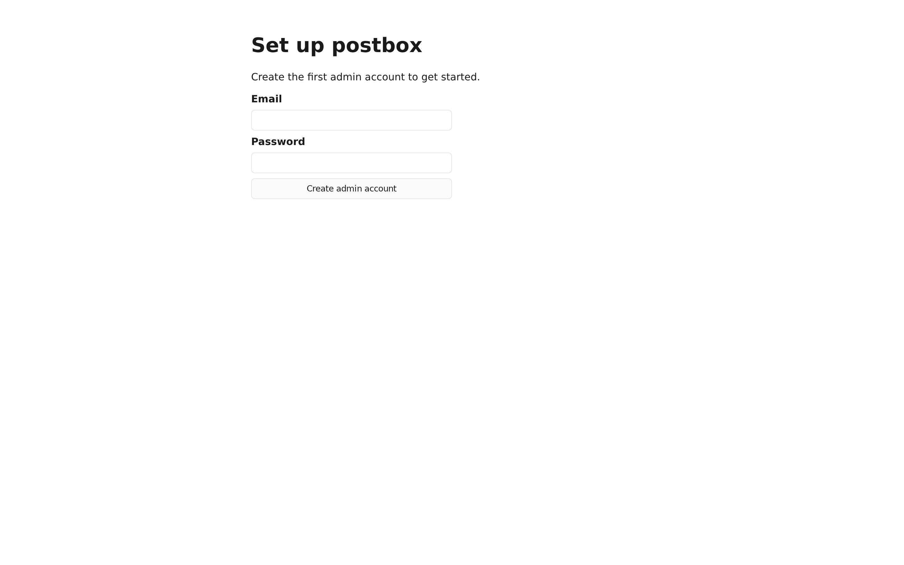
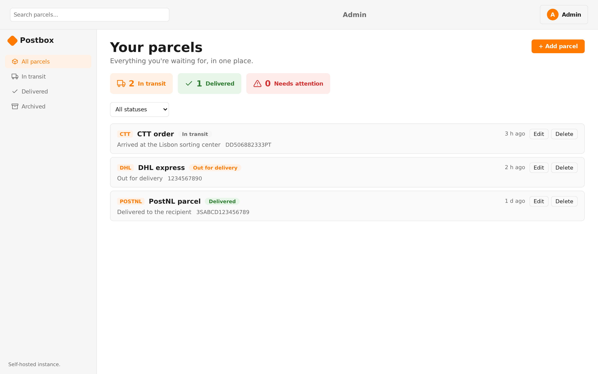
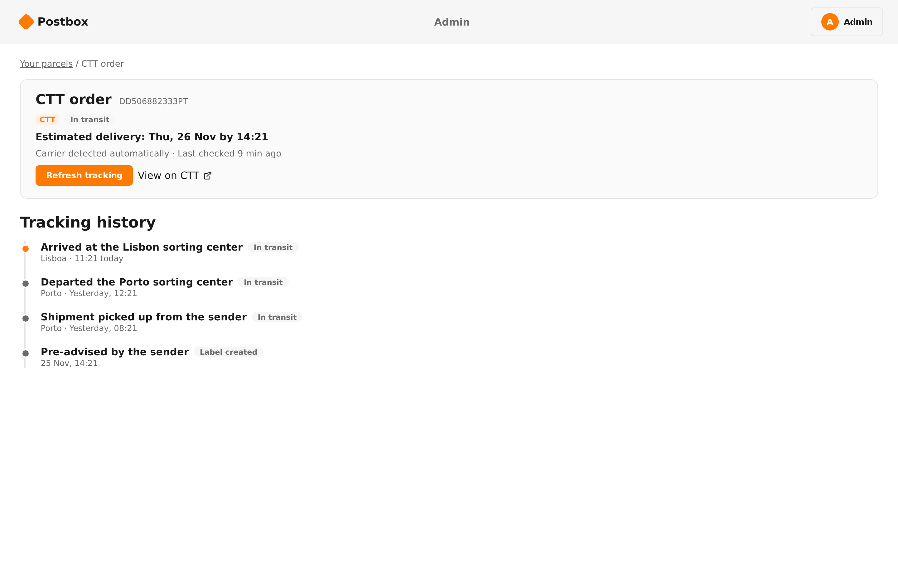

<h1 align="center">📮 postbox</h1>

<p align="center">
  <b>Self-hosted parcel tracking</b> — add a tracking number, get carrier
  auto-detection and a normalized timeline for every parcel.
</p>

<p align="center">
  <a href="https://github.com/GoncaloJoaoCorreia/postbox/blob/main/UNLICENSE"></a>
  <a href="https://github.com/GoncaloJoaoCorreia/postbox"></a>
  <a href="https://github.com/GoncaloJoaoCorreia/postbox"></a>
  <a href="https://github.com/GoncaloJoaoCorreia/postbox/actions/workflows/release.yml"></a>
  <a href="https://ghcr.io/goncalojoaocorreia/postbox"></a>
</p>

## Contents

- [About](#about)
- [Features](#features)
- [Screenshots](#screenshots)
- [Quick start](#quick-start)
- [Configuration](#configuration)
- [Admin runbook](#admin-runbook)
- [Carrier support](#carrier-support)
- [API](#api)
- [Development](#development)
- [License](#license)

<hr>

## About

postbox is a self-hosted parcel tracker: paste a tracking number and the app
detects the carrier, polls it within its rate limits, and shows one normalized
timeline per parcel. It is a Kotlin/Ktor backend with a React + TypeScript SPA
and SQLite storage, packaged as a single Docker container — API and web UI on
one port, configured entirely through environment variables.

Monorepo layout:

- `backend/` — Kotlin 2.x / Ktor 3.x (Netty) server (`:backend`)
- `frontend/` — Vite + React + TypeScript SPA
- `shared/` — Kotlin Multiplatform library for the mobile apps (`:shared`): OpenAPI-generated API client, SQLDelight cache, secure token/session storage
- `composeApp/` — Compose Multiplatform UI module for the mobile apps (`:composeApp`, android target; iOS targets later)
- `androidApp/` — Android app entry point (`:androidApp`): manifest, `MainActivity`, application class
- `docker/` — single-container `Dockerfile` and `docker-compose.yml`
- `docs/` — OpenAPI contract (`docs/openapi.yaml`), carrier research + fixtures, screenshots

<hr>

## Features

- **Add a parcel by tracking number** — the carrier is auto-detected (format rules → ranked candidates → parallel probe, first real hit wins) or set manually as an override
- **Normalized timeline** — every carrier's events map onto one status vocabulary (`PENDING`, `IN_TRANSIT`, `OUT_FOR_DELIVERY`, `DELIVERED`, `EXCEPTION`) with timestamp, location and the carrier's original text; estimated delivery when the carrier provides one
- **On-demand refresh** — opening the app re-checks parcels older than the staleness TTL (default 30 min) and a button forces a refresh; per-carrier rate limiters honor `Retry-After`, and a carrier outage never fails the list — the parcel carries a soft `lastCheckError` and serves cached data
- **Multi-user with roles** — admins create accounts (there is no public registration), deactivate/reactivate them and reset passwords; Argon2id password hashes, HS256 JWT bearer tokens
- **Self-hosted single container** — SPA + API + SQLite in one image on one port, published to GHCR on `v*` tags, data on a named volume, all config via env vars

<hr>

## Screenshots

First-run setup — create the first admin account:



The parcel list:



Parcel detail with the normalized event timeline:



<hr>

## Quick start

The image is published to GHCR on every `v*` tag. One command brings up a
running instance (data persists on the `postbox-data` volume):

```sh
docker run -d --name postbox \
  -p 8080:8080 \
  -v postbox-data:/data \
  -e JWT_SECRET="$(openssl rand -hex 32)" \
  ghcr.io/goncalojoaocorreia/postbox:latest
```

Or with the compose file from this repo:

```sh
git clone https://github.com/GoncaloJoaoCorreia/postbox.git
cd postbox/docker
echo "JWT_SECRET=$(openssl rand -hex 32)" > .env   # compose reads .env from here
docker compose up -d
```

Both serve the app on http://localhost:8080. Then:

1. Open http://localhost:8080 — with an empty database you land on the first-run setup wizard and create the admin account.
2. Sign in at `/login`. As admin, create further accounts in the Admin section (`/admin`) — see the [admin runbook](#admin-runbook).
3. Add a parcel by tracking number on `/parcels` — the carrier is detected automatically.

Useful commands: `curl http://localhost:8080/healthz` → `{"status":"ok"}`,
`docker logs -f postbox` for the structured JSON logs,
`docker compose down` (run from `docker/`) to stop.

To build the image from source instead of pulling it:
`docker build -f docker/Dockerfile -t postbox .` — see [docker/README.md](docker/README.md).

<hr>

## Configuration

All configuration is via environment variables (HOCON defaults in
`backend/src/main/resources/application.conf` are overridden by the matching
env var). The container image already sets `POSTBOX_ENV=production`,
`DATA_DIR=/data`, `SQLITE_PATH=/data/postbox.db` and `PORT=8080`.

| Env var | Default | Description |
| --- | --- | --- |
| `PORT` | `8080` | HTTP port the API and SPA listen on |
| `JWT_SECRET` | dev-only default | HS256 signing secret. **Must be overridden in any real deployment** — with `POSTBOX_ENV=production` the app refuses to boot on the default. Generate one with `openssl rand -hex 32` |
| `POSTBOX_ENV` | `dev` (`production` in the image) | Runtime environment; `production` enforces a non-default `JWT_SECRET` |
| `SQLITE_PATH` | `data/postbox.db` (`/data/postbox.db` in the image) | SQLite database file |
| `DATA_DIR` | `data` (`/data` in the image) | Data directory — mount it as a volume to persist data |
| `DHL_API_KEY` | unset | API key for DHL's official Shipment Tracking – Unified API, from the [DHL Developer Portal](https://developer.dhl.com). Unset → the DHL adapter is disabled with a startup warning (free tier: 250 calls/day, ≤ 1 call / 5 s, enforced client-side) |
| `DPD_FIREBASE_API_KEY`, `DPD_FIREBASE_ANDROID_CERT` | unset | Public myDPD app-bundle values for DPD's non-PT guest API path. Unset → PT tracking works, other countries degrade to "carrier unavailable" |
| `POSTBOX_REFRESH_STALE_AFTER_MINUTES` | `30` | How stale a parcel must be before opening the app re-checks it with its carrier |
| `POSTBOX_REFRESH_MAX_CONCURRENT_PROBES` | `4` | Cap on in-flight carrier probes during a refresh |
| `POSTBOX_REFRESH_DELIVERED_GRACE_DAYS` | `3` | Days after the last check during which a `DELIVERED` parcel skips refresh |
| `POSTBOX_CARRIER_<ID>_<KEY>` | per-carrier defaults in `application.conf` | Per-carrier HTTP tuning for `DHL`, `CTT`, `POSTNL`, `DPD`, `PAACK`, `ECOSCOOTING`: `CONNECT_TIMEOUT_MS`, `SOCKET_TIMEOUT_MS`, `REQUEST_TIMEOUT_MS`, `USER_AGENT`, `MIN_REQUEST_INTERVAL_MS` |

Example with plain Gradle (no Docker): `PORT=18080 JWT_SECRET=... ./gradlew run`,
then `curl http://localhost:18080/healthz`.

<hr>

## Admin runbook

### First-run setup

1. Open http://localhost:8080. While the database has no users you are redirected to `/setup`.
2. Create the first admin account (email + password, min. 8 characters). This works exactly once — after any account exists, `POST /api/v1/setup` answers `409 setup-already-completed` and the wizard redirects to `/login`.
3. Sign in at `/login` and add your first parcel.

### Managing accounts

There is no public registration (`/register` only says so). Admins manage accounts in the **Admin** section at `/admin`:

- **+ Add user** creates an account (`POST /api/v1/admin/users` with `email`, `password`, optional `displayName`/`role`) — the initial password can be generated and is revealed once with a copy button. Share those credentials with the new user; that is the "invite".
- Row actions deactivate/reactivate an account and reset its password (`PATCH /api/v1/admin/users/{id}`). Deactivated accounts get `401 invalid-credentials` at login, same as a wrong password. Your own admin account is protected from self-lockout.

### Backup and restore (SQLite)

The whole database is one SQLite file at `SQLITE_PATH` (`/data/postbox.db` inside the container, on the `postbox-data` volume). Stop the container first — that is the maintenance mode, no writes can be in flight — then dump or restore with any `sqlite3` CLI:

```sh
docker stop postbox
docker run --rm -v postbox-data:/data -v "$PWD:/backup" alpine:3 \
  sh -c "apk add --no-cache sqlite >/dev/null && sqlite3 /data/postbox.db .dump > /backup/postbox-$(date +%F).sql"
docker start postbox
```

Restore by piping a dump into a fresh database file (container stopped), then start it again:

```sh
docker stop postbox
docker run --rm -v postbox-data:/data -v "$PWD:/backup" alpine:3 \
  sh -c "apk add --no-cache sqlite >/dev/null && rm -f /data/postbox.db && sqlite3 /data/postbox.db < /backup/postbox-YYYY-MM-DD.sql"
docker start postbox
```

On a host with `sqlite3` installed you can also work directly on
`/var/lib/docker/volumes/postbox-data/_data/postbox.db` (needs root), with the
container stopped.

<hr>

## Carrier support

| Carrier | Endpoint | Credentials | Extra parcel metadata |
| --- | --- | --- | --- |
| DHL | **Official** — Shipment Tracking – Unified API (`api-eu.dhl.com`) | `DHL_API_KEY` from the [DHL Developer Portal](https://developer.dhl.com) | — |
| CTT (Correios de Portugal) | Unofficial — public object-search JSON API behind ctt.pt (`appserver.ctt.pt`) | none | — |
| PostNL | Unofficial — consumer track & trace API on `tracking.postnl.nl` | none | `postcode` (delivery postcode; the country is derived from its format) |
| DPD | Unofficial — PT: HTML tracker on `tracking.dpd.pt`; other countries: myDPD anonymous guest JSON API on `dpdgroup.com` | none for PT; `DPD_FIREBASE_API_KEY` + `DPD_FIREBASE_ANDROID_CERT` for the non-PT path | `country` (`PT` by default, `NL`) |
| Paack | Unofficial — consumer tracking endpoint on `paack.co` | none | `postcode` (delivery postcode) |
| EcoScooting | Unofficial — Cainiao's public link gateway behind `ecoscooting.com` | none | — |

The unofficial endpoints are the backends of the carriers' own public consumer
tracking pages. They need no account, but they can change or break silently —
when that happens postbox keeps serving the cached data and marks the parcel
with `lastCheckError` instead of failing.

When the resolved carrier needs metadata you have not provided yet, the app
prompts for exactly those fields (the API answers `409 missing-carrier-metadata`
with the field definitions, and the parcel response carries `missingMetadata`).
Save them with `PATCH /api/v1/parcels/{id}` and the next refresh succeeds.

Per-carrier research notes, probe scripts and captured fixtures live in
[`docs/carriers/`](docs/carriers/).

<hr>

## API

HTTP API under `/api/v1`, plus `GET /healthz` → `{"status":"ok"}` and the
OpenAPI 3 contract served unauthenticated at `GET /docs/openapi.yaml` (checked
in at [`docs/openapi.yaml`](docs/openapi.yaml)).

Public routes: `GET /api/v1/setup/status`, `POST /api/v1/setup`,
`POST /api/v1/auth/login`. Every other route requires an
`Authorization: Bearer <token>` header — an HS256 JWT signed with `JWT_SECRET`
(no cookies, no server-side sessions). Passwords are hashed with Argon2id.
Every error response uses one envelope: `{"error": {"code": "...", "message": "..."}}` — including `401` for missing/invalid tokens.

<details>
<summary>Full route list (also in <a href="docs/openapi.yaml">docs/openapi.yaml</a>)</summary>

- `GET /api/v1/setup/status` → `{"setupPending": true|false}` — true while the database has no users
- `POST /api/v1/setup` with `{"email", "password"}` → creates the first ADMIN account; `409` once any account exists
- `POST /api/v1/auth/login` with `{"email", "password"}` → `{"token": "..."}`; `401 invalid-credentials` for unknown email, wrong password and deactivated accounts alike
- `GET /api/v1/me` → the caller's account; `PATCH /api/v1/me` with `{"newPassword"}` → changes the caller's own password (`204`)
- Admin-only (`403 admin-required` otherwise): `GET /api/v1/admin/users` → all accounts; `POST /api/v1/admin/users` with `{"email", "password", "displayName"?, "role"?}` → creates an account (`201`); `PATCH /api/v1/admin/users/{id}` with `{"isActive"?, "newPassword"?}` → deactivate/reactivate and/or reset the password → the updated account (`404` for unknown ids)
- `GET /api/v1/parcels` → own parcels, each with its current `status`, `detectionMethod` and `latestEvent`, newest events first. On-demand refresh: parcels whose `lastCheckedAt` is older than the TTL (default 30 min, `POSTBOX_REFRESH_STALE_AFTER_MINUTES`) are refreshed from their carrier before the response is returned; fresh parcels serve cached data with no carrier traffic. DELIVERED parcels skip refresh after a grace window (default 3 days, `POSTBOX_REFRESH_DELIVERED_GRACE_DAYS`); in-flight carrier probes are capped (`POSTBOX_REFRESH_MAX_CONCURRENT_PROBES`, default 4) with per-carrier rate limiters respected and each probe bounded by the carrier's request timeout; a carrier outage never fails the list — cached data is served and the parcel carries a soft `lastCheckError`
- `POST /api/v1/parcels` with `{"trackingNumber", "displayName"?, "carrier"?, "metadata"?}` → `201` the created parcel (status `UNKNOWN` until first refresh); the tracking number is trimmed, length-capped and charset-checked. Without `carrier`, the detection engine resolves it (format rules → ranked candidates → parallel probe, first hit wins) and stores the outcome on the parcel (`carrier` + `detectionMethod`); an explicit `carrier` is a manual override (`detectionMethod: override`)
- `GET /api/v1/parcels/{id}`; `PATCH /api/v1/parcels/{id}` with `{"displayName"?, "archived"?, "carrier"?, "metadata"?}` (rename, archive, change carrier — a carrier change records `detectionMethod: override`); `DELETE /api/v1/parcels/{id}` → `204`. Other users' parcel ids return `404` (never `403`) so ids cannot be enumerated
- `GET /api/v1/parcels/{id}/events` → full normalized timeline, newest first
- `POST /api/v1/parcels/detect` with `{"trackingNumber", "carrier"?, "metadata"?}` → `200` `{"trackingNumber", "carrier", "method", "candidates"}` — `method` is `rule` (top candidate kept provisionally, no carrier knows the number yet), `probe` (a carrier returned real tracking data) or `override` (explicit `carrier`, never probed); `candidates` is the ranked format-rule list
- `POST /api/v1/parcels/{id}/refresh` → `200` the refreshed parcel, forcing a refresh regardless of TTL: new events inserted (deduplicated by the idempotency index), status recalculated, `lastCheckedAt` updated, `lastCheckError` cleared; on carrier outage the cached parcel comes back with `lastCheckError` set

</details>

<hr>

## Development

Prerequisites: JDK 17 (the Gradle wrapper auto-provisions a toolchain), Node.js
22+ for the frontend, Docker for the image.

Backend:

```sh
./gradlew run        # API on :8080; also serves the SPA when frontend/dist exists
./gradlew check      # compile + all tests (the QA gate)
./gradlew :backend:test --tests "com.postbox.HealthzTest"
PORT=18080 ./gradlew run   # any config key is overridable via env vars
```

Frontend (`frontend/`):

```sh
npm install
npm run dev      # Vite dev server, proxies /api to http://localhost:8080
npm run build    # tsc -b && vite build -> frontend/dist
npm run lint
npm run format
npm test         # Vitest + MSW
```

API contract: edit [`docs/openapi.yaml`](docs/openapi.yaml). The backend copies it
onto the classpath in `:backend:processResources` and serves it at
`GET /docs/openapi.yaml`; regenerate the frontend's typed client from the same
file with `npm run gen:api` (`openapi-typescript` → `src/api/schema.d.ts`). Keep
both in sync in the same change.

Carrier adapters: research notes per carrier in
[`docs/carriers/`](docs/carriers/) (`<carrier>.md`), probe scripts
(`*_probe.sh` / `*_probe.py`) and captured raw responses under
`docs/carriers/**/fixtures/` with personal data redacted.
`:backend:processTestResources` copies the fixtures onto the test classpath and
the adapter unit tests parse them via `getResource("/fixtures/...")`; live
integration tests only run with `POSTBOX_<CARRIER>_LIVE_TEST=true`. To add a
carrier: a `CarrierAdapter` implementation registered as a named
`provide<CarrierAdapter>(name = carrier.id)` binding in `AppDi.kt`
(`FakeCarrier` exists for tests), format rules in `TrackingNumberRules.kt`, and
any required per-parcel metadata declared in the adapter's `requiredMetadata`.

Docker image: `docker build -f docker/Dockerfile -t postbox .` — see
[docker/README.md](docker/README.md).

<hr>

## License

Released into the public domain under the [Unlicense](UNLICENSE).
